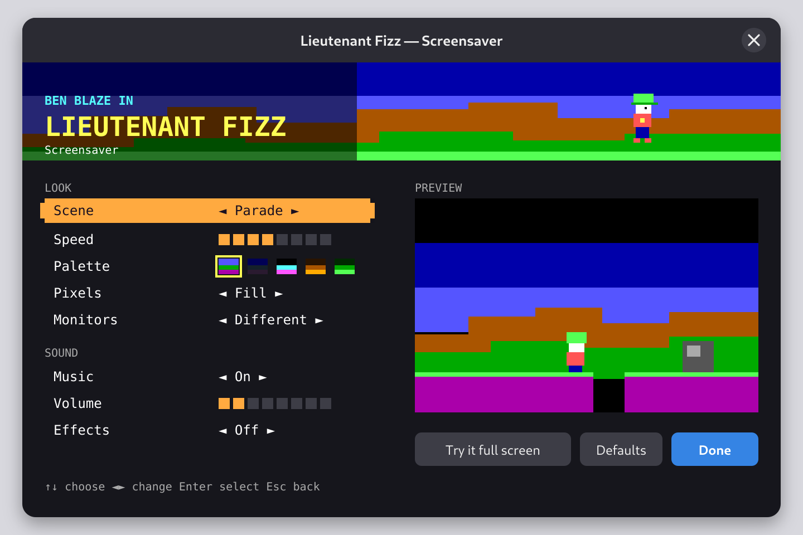

# Plan: the Lieutenant Fizz screensaver

**Status: planned, nothing built.** The build-ordered plan for issue #275: a Lieutenant Fizz screensaver for Windows, Linux and macOS, drawn by one small Rust core in a native host per OS (`FIZZ.SCR`, a Linux program, a `.saver` bundle) and chosen, previewed and tried in the desktop app, which also runs it as WASM. Section 7 compares this with making a tiny Tauri app the saver. Decisions are `FZS-1` to `FZS-30` (reserved here; packages that refine one say so in the same change). Concept art is in [`screensaver/`](screensaver/) (SVG masters, PNGs from `screensaver/render.sh`).


## Table of contents

- [1. What it shows](#1-what-it-shows)
- [2. Architecture](#2-architecture)
- [3. Pixels, scaling and monitors](#3-pixels-scaling-and-monitors)
- [4. Sound](#4-sound)
- [5. Settings](#5-settings)
- [6. Per OS](#6-per-os)
- [7. Option: a tiny Tauri app as the saver](#7-option-a-tiny-tauri-app-as-the-saver)
- [8. Installing it](#8-installing-it)
- [9. Cost, accessibility and safety](#9-cost-accessibility-and-safety)
- [10. Budgets](#10-budgets)
- [11. Testing and CI](#11-testing-and-ci)
- [12. Decisions](#12-decisions)
- [13. Owner decisions](#13-owner-decisions)
- [14. Work packages](#14-work-packages)
- [15. Sonnet briefs](#15-sonnet-briefs)
- [16. Risks](#16-risks)

## 1. What it shows

Looping, scripted attract-mode scenes: no simulation, no input, no physics. Every scene is a pure function of time (as the launcher's scenery already is, `apps/player/src/launcher/demo.ts`), so the same seed, settings, size and time always give the same frame, and a scene repeats exactly after its loop length.

| Scene | What happens | Source art | Music |
| --- | --- | --- | --- |
| **Title card** | The wordmark ("Ben Blaze in" over *Lieutenant Fizz*, "Episode 1: The Cocoa Caper") over the open-sky backdrop; Ben stands at its end, bobs, leans, hops up and pogoes across the top of it (the motions of `titleBen.ts`); the card drifts a pixel at a time | Fizz font, the title's own sprites (`ben-title.png`), `Theme::OpenSky` layers | `title` |
| **Crater Fields walk** | A real stretch of Crater Fields' tiles scrolls left under parallax mesas and hills; Ben runs, hops the gaps the tiles really have, grabs cream soda cans (they pop), stomps a gloop that is dazed by stars | `levels::build_level(CRATER)`, `BIOMES.crater`, `gloop`, `soda`, `stars` | `crater` |
| **Crystal Caves** | The caves' back wall at half speed, crystals pulsing through the palette's brightness levels, Ben climbing a vine and dropping onto a ledge while a bat flaps past | `CAVES`, `Theme::Caves` wall layer, `crysC`, `bat` | `caves` |
| **Meteor Mesa pogo** | Open sky, clouds and two rows of hills; Ben bounces along on the pogo stick and clears **the Roller** as it rolls downhill at him (the game's own answer to the rock roller: pogo over it) | `METEOR_MESA`, `Theme::OpenSky`, `roller` | `sky` |
| **Mildred's Citadel** | Purple walls and gold flecks; Ben fires fizz bubbles that stun a sentry, then walks under it | `CITADEL`, `sentry`, `bubble`, `stars` | `citadel` |
| **The Fizz wipe** (between scenes) | A big cream soda can tips into frame and its bubbles rise and fill the screen, carrying the next scene in | `soda` scaled 4x, `bubble` | the next scene's song fades in under it |

**Parade** (the default) plays them in turn with the Fizz wipe between each: title card, Crater Fields, Crystal Caves, Meteor Mesa, Mildred's Citadel, about 40 seconds each, about 3 minutes 40 in a loop (FZS-3). One scene can be chosen instead. With several monitors, each monitor starts at a different point of the parade by default (section 3).

Ben walks the ground the tiles really have: the core finds the top solid tile in each column of the strip and the script says only "walk from here to there"; a drop or a gap of one to three tiles becomes a hop arc, and a wall becomes a mantle. That keeps the scripts short and the motion honest to the level (FZS-4).

The overworld (Ben walking the map between landmarks with the pose workshop's eight-heading walk) and a **Live attract** scene (the game's own attract mode, through the real engine) are later scenes; see WP-FZS-12 and FZS-6.

## 2. Architecture

One portable core, one data pack per episode, and thin hosts.

```
crates/saver/                    lf-saver: no_std + alloc, game-agnostic. Indexed frame buffer, palettes and brightness levels,
                                 sprite and layer blitter, scene timeline player, ground finder, chip synth, settings table,
                                 pack reader (bounds-checked, never panics on bad input); raw C-ABI exports for WASM
episodes/episode-1/saver/        Episode 1's scene scripts (`scenes.ts`, data only) and the committed pack `fzsaver.pak`
episodes/episode-1/game/examples/saver-strips.rs
                                 dumps the chosen level stretches (tile ids) and each theme's parallax layers as JSON
scripts/build-saver-pack.ts      Bun: game sprites + level strips + pose-workshop frames + music notes + scenes -> the pack;
                                 `--check` (run by validate)
vendor/fizz-pose-workshop/       the subset of the workshop's frames the saver uses, with PROVENANCE.md (repo, commit, sums)
apps/player/saver.html           the app's saver page: settings screen, live preview, Try it full screen
apps/player/src/saver/           its TypeScript: boot, canvas presenter, exit rules, sound through GameAudio, settings screen
apps/player/src-tauri/src/saver.rs
                                 `--screensaver` (Try it, and the macOS fallback), `--screensaver-settings`, writing the
                                 native hosts' settings, the macOS idle login item
hosts/win32-scr/                 FIZZ.SCR: a no-C-runtime Win32 program (i586 and x86-64), its own Cargo workspace
hosts/linux/                     lieutenant-fizz-saver: xscreensaver hack, XFCE and MATE, full screen and the idle helper
                                 (winit, softbuffer, x11rb, cpal)
hosts/macos-saver/               LieutenantFizz.saver: a ScreenSaver-framework bundle in Swift over lf-saver as a static library
docs/SCREENSAVER.md              the specification (behaviour, settings, the pack format, per-OS integration)
```

- **Why a Rust core and not the Three.js engine (FZS-5).** A saver runs on machines left alone, often on several monitors, and must idle cheap. The game's renderer shades every device pixel with WebGL lighting; the saver's scenes are 16-colour pixel art at 320 × 200-style logical sizes, which a CPU draws in well under a millisecond. A small `no_std` core is also the only thing every host can share: the app runs it as WASM (as it runs the simulation, raw C-ABI exports and shared memory, no `wasm-bindgen`), and `FIZZ.SCR`, the Linux program and the macOS `.saver` link it natively, so the picture is the same byte for byte on every OS, and none of the native hosts needs a web view.
- **Why not the launcher's DOM scenery as it is.** It is CSS layers moved by transforms, which a native host cannot run, and its art is pre-drawn wide strips rather than real level tiles. The saver keeps its ideas (whole-pixel scale, a time-only demo script, the episode's own art) and moves the drawing into the core. The launcher could later draw through the same core; not part of this plan.
- **Engine and episode rules hold.** `lf-saver` is game-agnostic, as `crates/sim` is; everything Episode 1 brings (scripts, art, music) is data in its pack. Episode 2 adds its own `episodes/episode-2/saver/` pack, and the parade takes scenes from every pack the host has.
- **Indexed colour, as the DOS port.** The frame is one byte per pixel: `level × 16 + colour`, the 16 EGA colours at 14 brightness levels (the DOS port's scheme, `lieutenant-fizz-dos` `docs/ARCHITECTURE.md`), with level 14 full. Fades, the caves' crystal pulse and the night palette are level changes, never blends. A palette setting is a 256-entry lookup from that byte to RGB, applied only when the frame is shown.
- **The pack.** One file per episode, little-endian, `FZSP` and a version, a section table, then: palettes; sprite sheets (4-bit indexed, transparent 0, run-length rows, anchor and size per frame); layers (a tile strip's ids and its tile set, or a parallax picture with speed, base and tint); scenes (a small bytecode of actors, animations, path segments and cues); music (note events per track: start step, length, MIDI note, voice, gain, filter, envelope); and the strings the title card needs. Specified in `docs/SCREENSAVER.md` before the reader is written; the reader checks every offset and length and returns an error, never a panic (FZS-7).
- **Ben.** The game's Ben (16 × 24, `characters.ts`) is the scale every tile and enemy agrees with, but he has only a two-frame run. The pose workshop's rig (`fizz-pose-workshop`, `docs/RIG.md`, "Reuse with another character") samples a continuous skeleton into any number of frames; the saver gets a twelve-frame run, a twelve-frame pogo, a hop and an idle (helmet tip, wrist check) by sampling that rig with a **game-scale skin** (16 × 24, Ben's game colours), exported in the workshop and vendored here with provenance. Until that art lands, scenes use the game's own frames (FZS-8; owner decision 1).

## 3. Pixels, scaling and monitors

- **Whole pixels, any shape (FZS-9).** For a window `W × H` the scale is `s = max(1, floor(min(W / 320, H / 200)))`. **Fill** (the default) draws a logical canvas of `ceil(W / s) × ceil(H / s)` so the scene covers the screen with whole pixels and no bars, showing more of the level on wide screens and more sky on tall ones (the ground sits on the bottom edge, the sky continues up), with under `s` device pixels cropped on the right and bottom, as the game's Fast pixels do. **Letterbox** draws exactly 320 × 200 at `s` and centres it on black.

| Screen | `s` | Fill's logical size |
| --- | --- | --- |
| 1024 × 768 | 3 | 342 × 256 |
| 1366 × 768 | 3 | 456 × 256 |
| 1920 × 1080 | 5 | 384 × 216 |
| 2560 × 1440 | 7 | 366 × 206 |
| 3440 × 1440 | 7 | 492 × 206 |
| 3840 × 2160 | 10 | 384 × 216 |
| 1080 × 1920 (portrait) | 3 | 360 × 640 |
| Preview pane, 152 × 112 | 1 | 152 × 112 (the scene is framed on Ben, not cropped from 320) |

- **Presenting.** The app copies the RGB frame into a canvas of the logical size with `putImageData` and lets CSS scale it by `s` with `image-rendering: pixelated`, so the GPU does one quad. `FIZZ.SCR` scales with `StretchDIBits` (`COLORONCOLOR`) at whole multiples; the Linux program through softbuffer (or `XPutImage` into xscreensaver's window) of a frame the core scales by an integer; the `.saver` hands a `CGImage` to Core Animation with nearest filtering.
- **Monitors (FZS-10).** `Monitors`: **Different** (the default: each monitor its own scene, monitor `i` starting `i × loop / n` into the parade with seed `seed ⊕ i`), **Same** (one view drawn at each monitor's own size) or **Primary** (the others black). Each monitor gets its own scale, so a 4K and a 1080p screen side by side are both crisp. Sound comes from the primary monitor's view only. The app (Try it, the macOS fallback) and the Linux program's full-screen mode open one borderless window per monitor; `FIZZ.SCR` covers the virtual screen with one window and one viewport per monitor (`EnumDisplayMonitors`); xscreensaver and XFCE run one hack process per monitor, and each finds its monitor from its window (as SAV-D74 does); macOS makes one `ScreenSaverView` per screen.

## 4. Sound

- **The episode's own music, quietly (FZS-11).** Each scene plays its level's song (table in section 1) at **Volume 25** of the app's Music level, on by default, fading up with the picture over two seconds and cross-fading at each wipe; it stops at once when the saver ends. Effects (the boing, the pop of a can, the crunch of a stomp) are a separate setting, **off** by default.
- **In the app** (the preview stays silent; Try it and the macOS fallback play) the music is the game's own: `GameAudio` playing the episode's patterns (Classic, or Enhanced where the app's Sound option says so), as the launcher already plays the title theme from `theme.json`. No new sound code in the app.
- **In the native hosts** (`FIZZ.SCR`, the Linux program, the `.saver`), which are the saver on every OS, there is no Web Audio, so the core carries a small **chip synth**: square, triangle, sawtooth, sine and noise voices with an ADSR envelope, one-pole low- and high-pass filters and a short feedback delay, which are the controls the game's voices use (`SfxVoice`, `MusicPart` in `packages/engine/src/audio.ts`). `build-saver-pack.ts` turns each song into note events with the engine's own mini-notation parser, so the notes are the game's notes; the timbre is close to Classic, not identical (FZS-12). It renders 16-bit stereo at 22,050 Hz (Pentium) or 48,000 Hz, deterministic from the sample clock.
- **Where it plays.** `waveOut` on Windows (the Afterglow savers' three-buffer path, SAV-D48), ALSA through `cpal` for the Linux program (PipeWire and PulseAudio answer through their ALSA plug-ins), `AVAudioEngine` with a source node on macOS. Silent in every preview and settings pane, silent with no message when no device opens, and silent as an xscreensaver hack unless `--sound` is given (a hack runs at a locked desktop as well).
- **Autoplay.** The app's web view must play without a gesture in Try it and the macOS fallback: WebView2 and WebKitGTK allow it for app content; on macOS the app mode needs `mediaTypesRequiringUserActionForPlayback` cleared (checked in WP-FZS-4, risk R3).

## 5. Settings

One table in the core (`lf_saver::settings`: key, range, default), read by every host; a missing or out-of-range value is the default, and only a settings screen writes (FZS-13).

| Key | Meaning | Range | Default |
| --- | --- | --- | --- |
| `scene` | 0 Parade, 1 Title card, 2 Crater Fields, 3 Crystal Caves, 4 Meteor Mesa, 5 Mildred's Citadel | 0–5 | 0 |
| `speed` | Percent of normal | 25–200 | 100 |
| `music` | Play the scene's song | 0–1 | 1 |
| `volume` | Percent of the Music level | 0–100 | 25 |
| `effects` | Play the scene's sound effects | 0–1 | 0 |
| `palette` | 0 EGA, 1 Night (the game's night tints), 2 CGA (cyan, magenta, white), 3 Amber, 4 Green phosphor, 5 Grey | 0–5 | 0 |
| `pixels` | 0 Fill, 1 Letterbox 320 × 200 | 0–1 | 0 |
| `scanlines` | Darken every other device row inside each logical pixel (a CRT hint; only at `s` ≥ 3) | 0–1 | 0 |
| `monitors` | 0 Different, 1 Same, 2 Primary | 0–2 | 0 |
| `fps` | Frame cap | 15–60 | 30 |
| `motion` | 0 System, 1 Reduced, 2 Full (section 9) | 0–2 | 0 |
| `seed` | 0 for a new one each run | any | 0 |

- **Where they live.** Each OS has one store that its native host reads, and the app's settings screen writes it as well as keeping `lf-saver-v1` in its own store for Try it: on Windows `HKCU\Software\Liminal HQ\Lieutenant Fizz\Screensaver` (`REG_DWORD`s by the same names), on Linux `~/.config/liminal-hq/lieutenant-fizz/saver.toml` (the Afterglow Linux edition's form), and on macOS the `.saver`'s `ScreenSaverDefaults`, which only its own Options sheet writes (the legacy host's sandbox keeps them in its container); the app's macOS fallback uses `lf-saver-v1`.
- **The settings screen (FZS-14).** In the app, a screen in the game's menu language (stepped plate, the can as bullet, Fizz font, keyboard, pad and mouse) laid out as the Afterglow dialogs are: a banner that is the saver's own scene at a fixed moment, darkened under the title; **Look** (scene, speed, palette as swatches, pixels, scanlines, monitors); **Sound** (music, volume, effects); a **live preview** at the pane's size; and **Try it full screen**, **Defaults** and **Done**. It opens from App settings in the launcher (a new **Screensaver** row) and from each OS's screensaver settings (section 6). Every string goes through the launcher's messages.



- **Native settings** where the app is not there: `FIZZ.SCR` without the app shows a plain Win32 dialog (Scene, Speed, Music, Volume, Palette; the Afterglow plain dialog's shape, built at run time from controls Windows 95 has); the `.saver` gives an AppKit sheet with the same rows; xscreensaver gets an XML dialog that writes command-line flags.

## 6. Per OS

The picture comes from a native host on every OS: each system's own screensaver interface needs a native program or bundle anyway (a preview pane to draw into, a window xscreensaver hands over, a `.saver` bundle), and the saver need not look like the game, so it does not need the app's rendering pipeline (FZS-23). The app is where people choose and try the saver, and on macOS it is the fallback when the `.saver` cannot run. Section 7 compares this with making a tiny Tauri app the saver everywhere.

### What the app does (all three)

- **Settings and trying it.** The settings screen (section 5), its live preview, **Try it full screen**, **Use as my screensaver** (Windows), **Install the screensaver** (macOS) and the Linux set-up commands, from a new **Screensaver** row in App settings. The preview and Try it run the same core as WASM, so they show exactly what the native hosts show.
- **`lieutenant-fizz --screensaver`** opens one borderless, always-on-top window per monitor on `saver.html`, hides the pointer and runs until input: it is what **Try it full screen** starts, and the macOS fallback below. `--screensaver-settings` opens the settings screen in one window.
- **Ending (FZS-15):** any key or mouse button, a pointer move of more than 10 device pixels from where the first move found it, losing focus after having had it, or the process being told to close. It ends at once (no fade out), never opening the launcher, and writes nothing to the store.
- **In-app idle:** App settings › Screensaver › **Start when idle** (Off, 5, 10, 15 minutes; Off by default) starts the saver inside the running app after that long without input on the launcher or a menu, never during play.
- **During play** the OS screensaver should not start at all; the game holding the system awake while a level is played is a separate change (risk R6).

### Windows (first)

- **`FIZZ.SCR`** is a real screensaver program (WP-FZS-6), built as the Afterglow savers are: Rust with no C runtime, `core` built from source for a Pentium (i586, x87) and for x86-64, ANSI imports on an allow list, its plumbing (the runtime glue, the system bindings, the command line, the registry, `waveOut`, the window and exit rules) copied from `afterglow-savers` `platforms/win32` with a `PROVENANCE.md` naming the commit (FZS-16). It draws every mode itself from the pack embedded in it (FZS-24):
  - **`/s`** covers the virtual screen with one window and a viewport per monitor and plays the chip score. Windows ends the saver by ending this process, so "On resume, display logon screen" keeps working with nothing extra.
  - **`/p <hwnd>`** draws into the Display applet's pane, 15 frames a second, silent.
  - **`/c`** opens the app's settings screen (`lieutenant-fizz.exe --screensaver-settings`, found through the installers' uninstall key `InstallLocation`, then beside the `.scr`) and waits for it; without the app it shows a plain Win32 dialog.
  - The same file runs on Windows 95 to 11 and ReactOS, with or without the app.
- Listed as "Lieutenant Fizz" by string 1, with the game's icon as resource 101.
- **Windows 3.x** is a later, separate 16-bit program (WP-FZS-11), as `QUILLGW.SCR` was for Quill: the title card and one scene in the 16 VGA colours, which are nearly the EGA palette already.

### Linux

GNOME and KDE have no interface for a third-party screensaver; their lock screens draw their own picture (afterglow-savers `docs/linux-packages.md`, SAV-D69). One native program, `lieutenant-fizz-saver` (`hosts/linux`, winit and softbuffer for windows on X11 and Wayland, x11rb for xscreensaver's window, `cpal` for sound), does each job (FZS-25):

| Desktop | How the saver starts | Settings |
| --- | --- | --- |
| xscreensaver (X11 window managers, LXQt) | `lieutenant-fizz-saver -window-id` as a hack, listed as "Lieutenant Fizz": by itself on Fedora (`hacks.conf.d`), after `lieutenant-fizz-saver --setup xscreensaver` (per user, no administrator) on Debian, Ubuntu and Arch | xscreensaver's dialog (installed XML), and the settings file |
| XFCE (`xfce4-screensaver`), MATE | A `.desktop` in `/usr/share/applications/screensavers/` running it with `-root` | The settings file |
| GNOME (Wayland), KDE Plasma, Cinnamon, Budgie | `lieutenant-fizz-saver --idle` as a user service (installed, not enabled): Mutter's IdleMonitor on GNOME, `org.freedesktop.ScreenSaver.GetSessionIdleTime` on KDE, `xprintidle` on X11; it opens one full-screen window per output and skips while the session is inhibited | The app, or the settings file |
| sway, Hyprland and other wlroots compositors | `swayidle -w timeout 300 lieutenant-fizz-saver` (documented) | The settings file |

- No WebKitGTK is involved: xscreensaver hands the hack a window to draw into, which a web view cannot do, and the full-screen and idle cases are the same drawing in windows of its own.
- **Packaging (FZS-17).** The deb and rpm from `bun run tauri build --bundles deb,rpm` carry the program as a Tauri `externalBin`, and its XML, the XFCE and MATE `.desktop`, Fedora's `hacks.conf.d` line and the idle user unit through `bundle.linux.deb.files` and `bundle.linux.rpm.files`. The AppImage carries the program but no system files (it has no fixed path for xscreensaver or a unit to name); its users run `lieutenant-fizz-saver --idle` from their session's autostart. A Flatpak is not built today; when it is, the idle mode is its route.

### macOS

- **The only real route is a ScreenSaver-framework bundle** (`LieutenantFizz.saver`, WP-FZS-9). Since macOS 10.15 third-party savers run inside Apple's sandboxed `legacyScreenSaver` host, which brings known constraints that the bundle must work around: an instance may not be torn down when the saver ends (on 14 and later `stopAnimation` may never arrive), so the view stops and the process exits on the `com.apple.screensaver.willstop` distributed notification; each screen gets its own view, so sound plays from the main screen's only; the bundle must carry both `arm64` and `x86_64`; and the sandbox cannot read the app's data, so settings are `ScreenSaverDefaults`, set from the bundle's own Options sheet.
- **Native, not a web view (FZS-18).** The bundle links `lf-saver` as a static library and draws its frames as a `CGImage`; it does not host a `WKWebView` (a web content process inside `legacyScreenSaver` is heavy and has been unreliable) and does not launch an app (an app cannot draw above the screensaver window). Sound is the chip synth through `AVAudioEngine`.
- **Signing.** The release's `.dmg` is ad-hoc signed and not notarised, and the `.saver` would be the same: on a first install macOS refuses it until it is allowed in System Settings › Privacy & Security. That works, but it is not a good first experience; notarising needs an Apple Developer ID (owner decision 9). The `.saver` ships as a zip beside the `.dmg` and inside the app's Resources, with an **Install the screensaver** row in App settings that opens it (System Settings then installs it for the user).
- **Fallback (FZS-26):** when the `.saver` is not allowed, or a macOS release breaks the legacy host, the app's own saver: **Start when idle** inside the app, and `lieutenant-fizz --screensaver-idle` as an opt-in login item that watches `CGEventSourceSecondsSinceLastEventType` and starts `--screensaver`. It cannot replace the system screensaver or lock screen, so the system saver should be set longer than its delay. Section 7 weighs a tiny separate Tauri app for this role instead.

## 8. Option: a tiny Tauri app as the saver

The owner asked whether the saver should instead be a **tiny Tauri app**: a minimal shell (no game, no launcher, few plugins) that runs the same WASM core full screen on every OS. Measured sizes are from the v0.5.0 release; times and costs marked *estimate* are to be measured before anyone relies on them.

| | Native hosts on the core (this plan) | A tiny Tauri saver app |
| --- | --- | --- |
| **Code** | One core; three thin hosts (`FIZZ.SCR` in no-std Rust, one Rust program for Linux, a Swift `.saver`), each a few hundred lines over the core plus the copied Afterglow plumbing on Windows | One core and one shell (Rust and a page) for all three, but each OS still needs its native piece (rows below), so it is one shell **plus** most of the native hosts |
| **Monitors** | One window and viewport per monitor (`EnumDisplayMonitors`, winit's monitor list, one `ScreenSaverView` per screen); each crisp at its own scale | One web-view window per monitor from `available_monitors()`. macOS native full screen moves each window into its own Space with an animation, so the windows must be borderless at screen-saver level instead; on Wayland a client cannot place a window, so it relies on full screen on a chosen output (*unverified in tao*). Each window is a web view of its own: roughly 80 to 150 MB per monitor (*estimate*) |
| **Start-up** | Under 0.1 s to the first frame (*estimate*); `FIZZ.SCR` shows black at once | A web-view cold start, about 0.3 to 1.5 s (*estimate*; WebView2 and WebKitGTK both start a browser process), then the page, the WASM and the pack |
| **Idle cost** | The core's blit (well under 1 ms a frame) and a GDI, softbuffer or Core Animation present: about 1% of a core at 30 fps (*estimate*), no GPU work beyond the copy | The same core, plus a web view's event loop, `requestAnimationFrame`, canvas upload and compositing per window: a few percent of a core and a GPU compositor kept awake (*estimate*) |
| **Windows `.scr`** | `FIZZ.SCR` is the saver: `/s`, `/p`, `/c` and the preview pane natively, Windows 95 to 11 | A Tauri `.exe` renamed `.scr` would run `/s` and `/c`, but not `/p`: a Tauri window cannot be made a child of the Display applet's preview window, and WebView2's data folder would default beside the file (not writable in `System32`). It needs WebView2, so Windows 10 and 11 only. In practice it still needs a native stub for `/p` and for older Windows, which then launches the app for `/s` and must keep the process alive for the secure-resume lock: more parts, not fewer |
| **Linux** | One program: xscreensaver hack, XFCE and MATE, and the idle helper | A web view cannot draw into the window xscreensaver gives a hack, so the hack stays native. The tiny app could be what the idle helper starts on GNOME, KDE and wlroots |
| **macOS** | A `.saver` bundle; fallback is the game app's idle mode | A Tauri app **cannot be a `.saver`**: a `.saver` is a loadable bundle whose principal class is a `ScreenSaverView`, loaded into `legacyScreenSaver`; Tauri builds an application. The tiny app can only be the idle fallback (a login item that goes full screen on idle), which the game app already provides |
| **Download and install size** | `FIZZ.SCR` up to 384 KiB; the Linux program about 2 MiB; the `.saver` about 3 MiB zipped; all inside the game's existing packages | Its own packages, beside the game's or instead of them. The game's v0.5.0 packages are 4.0 to 4.2 MB (NSIS), 4.8 to 4.9 MB (MSI), 4.8 MB (deb and rpm), 9.6 MB (universal `.dmg`) and 112 MB (AppImage, which bundles WebKitGTK and GStreamer); a tiny app would be a little smaller than the first five and about the same as the AppImage. It needs WebView2 on Windows and `webkit2gtk-4.1` on Linux (tens of MB where it is not already installed) |
| **Updates** | Ride the game's releases (no updater is used today) | Its own release line, or Tauri's updater plugin (new signing keys and an update feed) |
| **Signing** | Windows: the `.scr` arrives inside the game's installer (unsigned today; SmartScreen warns on the installer, not on the `.scr`). macOS: the `.saver` needs ad-hoc signing now and a Developer ID to notarise. Linux: unsigned packages | Windows: one more unsigned download for SmartScreen to warn about. macOS: one more app to sign and notarise, on top of the `.saver` it cannot replace. Linux: the same |
| **Settings UI** | The game app's settings screen, plus small native dialogs where the app is absent (`FIZZ.SCR` alone, the `.saver`'s sheet, xscreensaver's XML) | Its own web settings screen everywhere (the one design, without the game installed) |

**Recommendation: staged (FZS-27).**

1. **Native core and native hosts first** (WP-FZS-1 to WP-FZS-9): every OS's real screensaver interface needs them, they start instantly, idle cheapest and add a few hundred KB to a few MB to packages people already install.
2. **The game app as the chooser and the macOS fallback** (WP-FZS-4): settings, preview, Try it, and the idle mode, on the WASM core, with no new bundle.
3. **A tiny Tauri saver app only if the saver must ship without the game** (WP-FZS-13, not scheduled): a separate download with its own settings screen, reusing `saver.html` and the WASM core, as the idle-mode host on macOS and Linux. It does not replace `FIZZ.SCR`, the Linux hack or the `.saver`, which it cannot be.

## 8. Installing it

- **The app's own installers (FZS-19).** The Windows release builds `FIZZ.SCR` (x86-64; arm64 Windows runs it emulated) before `tauri build` and adds it as a resource. The NSIS installer (per-user, Tauri's default) cannot write to the system folder, so it puts `FIZZ.SCR` beside the app, and the app's **Use as my screensaver** button sets `HKCU\Control Panel\Desktop` `SCRNSAVE.EXE` to its short path (the Display applet runs it unquoted) and `ScreenSaveActive` to 1. The MSI (per-machine) also installs it to `System32` through a WiX fragment, so it is listed by Screen Saver Settings for every user. Uninstalling removes it, and leaves `SCRNSAVE.EXE` alone when it names a removed file (Windows falls back to none).
- **The Liminal Installer's Lt. Fizz example.** Its unticked `screensaver` component (`examples/lt-fizz/installer/components.toml`, `{windows}/`, liminal-installer D97) carries a text stand-in today. WP-FZS-10 replaces it with the i586 `FIZZ.SCR` (pack embedded; it needs no app), copied into `examples/lt-fizz/installer/dist/screensaver/` with a `PROVENANCE.md` (this repository's commit and the file's SHA-256), as Quill vendors `AGQUILL.SCR`. The Windows 3.1 target keeps the stand-in until the Win16 edition exists (owner decision 13).
- **Linux and macOS:** section 6.

## 9. Cost, accessibility and safety

- **Idle cheap (FZS-20).** 30 frames a second by default; a frame whose picture would not change (a held title card, Reduced motion) is not drawn or presented again; the native hosts present one copy per frame; the app's saver page stops its loop when hidden and scales one canvas per monitor in the compositor, with no WebGL. The core draws a 384 × 216 frame in well under a millisecond on a current CPU; the budget in section 10 is measured in WP-FZS-4 and WP-FZS-6.
- **Reduced motion (FZS-21).** `motion` System follows the OS (`prefers-reduced-motion` in the app, `SPI_GETCLIENTAREAANIMATION` on Windows, `accessibilityDisplayShouldReduceMotion` on macOS, GNOME's `enable-animations`). Reduced shows **postcards**: still frames of each scene (Ben at a fixed pose, no parallax) cut with a slow two-second fade every 20 seconds, and a one-pixel drift so nothing burns in. Full ignores the OS.
- **No flashing.** Nothing changes brightness more than three times a second over a large area: the crystal pulse is under 1 Hz, the stun stars are small, the wipe's bubbles rise without strobing.
- **Burn-in.** Nothing is static for more than 30 seconds: the title card drifts, the parade moves on, and postcards drift.
- **Locking** stays the OS's: Windows' secure screensaver through the `.scr` process, Linux and macOS lock screens at their own timeouts. The saver never asks for or stores a password.

## 10. Budgets

Guards, checked by scripts and CI, not targets; raising one is a recorded decision with the measured cost.

| Item | Budget |
| --- | --- |
| Episode 1 pack `fzsaver.pak` | 160 KiB |
| `lf_saver.wasm` (after `wasm-opt -Oz`) | 64 KiB |
| `FIZZ.SCR`, i586 and x86-64, each, pack included | 384 KiB (the Afterglow guard, SAV-D29) |
| `lieutenant-fizz-saver` (Linux), stripped | 2 MiB |
| `LieutenantFizz.saver`, universal, zipped | 3 MiB |
| Core frame time, 384 × 216, host build | 1 ms (reported by a bench in CI, failing at 4 ms) |
| App's Try it and macOS fallback, 1920 × 1080, one monitor, 30 fps | under 5% of one core and under 200 MB resident, measured on the owner's Linux machine and the Windows 11 VM |
| `lieutenant-fizz-saver`, 1920 × 1080, 30 fps | under 3% of one core, under 30 MB resident |
| `FIZZ.SCR`, 1920 × 1080, 30 fps | under 3% of one core (Wine and the VM) |
| `FIZZ.SCR`, Pentium-class (86Box or real) | 20 frames a second at 640 × 480 at 22,050 Hz; not verified until a machine or 86Box is set up |
| `/s` and the Linux program to first frame | 100 ms |

## 11. Testing and CI

| What | How | Where it runs |
| --- | --- | --- |
| Core | `cargo test -p lf-saver`: golden frame hashes per scene at fixed times and sizes, loop exactness, determinism, the ground finder, scale maths, settings ranges, the pack reader on truncated and corrupt packs (and a `cargo fuzz` target run locally) | CI `rust` job |
| Pack | `bun scripts/build-saver-pack.ts --check` (committed pack matches its inputs), size guard | CI `web` job, through `bun run validate` |
| Pictures | `cargo run -p lf-saver --example preview` writes PNG frames, an MP4 (ffmpeg) and a WAV of the chip score per scene into the evidence folder | Local; frames attached to PRs |
| App | Vitest for the boot, exit rules, scale and settings screen state; Playwright on `saver.html?host=fake-desktop` at 1280 × 720, 1920 × 1080, 3440 × 1440, 1024 × 768 and portrait, with reduced motion, screenshots compared by hash | CI Chromium shards |
| App on each OS | Try it on X11 (Xvfb with two RandR monitors), headless sway with two outputs, the Windows 11 VM (WebView2) and a Mac when one is available | Local; evidence |
| `FIZZ.SCR` | Host tests of the command line and app finding; build both arches, size guard, import allow list, Pentium instruction scan; Wine: `/s` (frames captured), `/p` in the preview stand-in, `/c` with no app (the dialog) and with a stub app that records its arguments; ReactOS guest: Display applet lists and previews it | CI `saver-win32` job (container with Wine); ReactOS locally |
| Linux program | Build, `-window-id` on Xvfb, `-root`, full screen on a two-monitor Xvfb and on headless sway with two outputs, `--idle` against a fake idle source, xscreensaver in a Debian container listing it after the setup command; packages install and uninstall in containers | CI `saver-linux` job; containers locally |
| macOS `.saver` | Build universal, an XCTest that makes a `ScreenSaverView` off screen and checks a frame's hash against the core's | CI `saver-macos` on `macos-latest`; real use on a Mac only |
| Installers | liminal-installer's Wine and Windows 3.11 e2e with the real `FIZZ.SCR` | liminal-installer CI |

CI follows the repository's rule of one job per check: `saver-win32`, `saver-linux` and `saver-macos` join `ci.yml` (the macOS one only on changes under `crates/saver/` and `hosts/macos-saver/`), and `release.yml` gains the `FIZZ.SCR`, Linux program and `.saver` builds in the existing Windows, Linux and macOS jobs. Nothing new is released until a tagged release does it.

All evidence goes to `~/Documents/Liminal HQ/Lieutenant Fizz/Screensaver/`, one numbered folder per package (`01 Core`, `02 Pack`, `03 Scenes`, `04 App`, `05 Chip synth`, `06 FIZZ.SCR`, `07 Windows installers`, `08 Linux`, `09 macOS`, `10 Liminal Installer`), each with a `README.md` saying what each file shows and what it does not verify. The concept art is in `00 Plan concept art`.

## 12. Decisions

The repository's plans keep a Decisions list; these use the `FZS-` prefix so parallel work never clashes (FZS-1 to FZS-30 reserved). **Assumed** means a default taken while the owner has not answered; each names where to swap it.

- **FZS-1 — Where it lives.** In this repository, beside the app: not in `afterglow-savers` and not a new repository. *Decided by the owner (2026-11-27).*
- **FZS-2 — Platforms.** Windows, Linux and macOS, the app included; `FIZZ.SCR` also covers Windows 95 to 8.1 and ReactOS; Windows 3.x later through its own 16-bit program. *Decided by the owner (platforms); Assumed (the older Windows).*
- **FZS-3 — The parade.** Five scenes with the Fizz wipe, about 40 s each, the default scene. *Assumed.* Swap: `episodes/episode-1/saver/scenes.ts`.
- **FZS-4 — Ben walks real ground.** Scripts name stretches; the core derives hops and mantles from the tile strip. *Assumed.* Swap: the scene bytecode's `walk` op.
- **FZS-5 — A Rust core, WASM in the app.** Not the Three.js renderer, not a canvas port in TypeScript. *Assumed.* Swap: WP-FZS-12 adds the real engine as one more scene.
- **FZS-6 — Live attract is a later scene.** The episode's own attract mode in the app only, at Fast pixels. *Assumed.*
- **FZS-7 — One pack per episode, committed.** Built by a Bun script from the game, checked by `--check`, so no host build needs Bun or the other repositories (the DOS port's rule). *Assumed.*
- **FZS-8 — Ben's frames.** The game's Ben at game scale, with extra frames sampled from the pose workshop's rig with a game-scale skin; the workshop's 16 × 32 Ben is not used beside 16-pixel tiles. *Assumed.* Swap: `BEN_SOURCE` in `scripts/build-saver-pack.ts`.
- **FZS-9 — Whole-pixel scaling, Fill by default.** *Assumed.* Swap: the `pixels` default.
- **FZS-10 — Monitors: Different by default; sound from the primary.** *Assumed.* Swap: the `monitors` default.
- **FZS-11 — Music on at 25, effects off.** Following the Afterglow savers' choice to play quietly by default (SAV-D35). *Assumed.* Swap: the settings table.
- **FZS-12 — Two sound paths.** The app plays the game's real music; native hosts play the same notes on the core's chip synth. *Assumed.* Swap: the app can play the chip synth through an `AudioWorklet` for identical sound everywhere.
- **FZS-13 — One settings table, per-host storage.** *Assumed.*
- **FZS-14 — The settings screen is the app's, in the game's look with the Afterglow layout.** Not the Afterglow Win32 dialog. *Assumed.* Swap: section 5.
- **FZS-15 — Ending rules.** Key, button, a 10-pixel move, focus lost; no fade out. *Assumed* (Afterglow SAV-D10, SAV-D30).
- **FZS-16 — `FIZZ.SCR` copies the Afterglow Win32 plumbing with provenance.** Not a git dependency: `afterglow-savers`' shell is built around its own `SaverKind` and finishing chain, and copying with a `PROVENANCE.md` is the house pattern (the Win16 toolchain in `afterglow-savers`, Desk's foundation in the installer). *Assumed.* Swap: depend on a shared crate if `afterglow-savers` ever splits one out.
- **FZS-17 — Linux packaging: the program and its system files in the deb and rpm; the program alone in the AppImage.** *Assumed.* Swap: `tauri.conf.json` `bundle.linux`.
- **FZS-18 — macOS: a native `.saver`, no web view; ad-hoc signed until there is a Developer ID.** *Assumed.*
- **FZS-19 — Windows: per-user NSIS sets `SCRNSAVE.EXE`; the per-machine MSI installs to `System32`.** *Assumed.*
- **FZS-20 — 30 frames a second, no redraw without change.** *Assumed.*
- **FZS-21 — Reduced motion shows postcards.** *Assumed.*
- **FZS-22 — Decision prefix `FZS-`.** *Assumed.* Swap: renumber in this file.
- **FZS-23 — The saver may differ from the game.** It need not use the app's rendering pipeline; native hosts draw it on every OS and the app chooses, previews and tries it. *Decided by the owner (2026-11-27).*
- **FZS-24 — `FIZZ.SCR` draws every mode itself.** It does not launch the app for `/s` (first planned as a launcher role, dropped: a web-view start-up, a job object and two processes bought nothing the native picture lacks); `/c` opens the app's settings when the app is there. *Assumed.* Swap: `hosts/win32-scr/src/main.rs`.
- **FZS-25 — One Linux program for every desktop.** `lieutenant-fizz-saver` is the hack, the full-screen saver and the idle helper; the app is not started for any of them. *Assumed.* Swap: the idle helper could start `lieutenant-fizz --screensaver` instead.
- **FZS-26 — macOS fallback: the game app's idle mode.** *Assumed.* Swap: WP-FZS-13's tiny app, or the Linux program built for macOS.
- **FZS-27 — Staged, not a tiny Tauri saver app.** Native core and hosts first, the game app as chooser and macOS fallback, a tiny Tauri app only if the saver must ship without the game (section 7). *Assumed.* Swap: schedule WP-FZS-13.

## 13. Owner decisions

Each as question, default taken, and where to swap it.

1. **Ben's art:** the game's 16 × 24 Ben with rig-sampled extra frames, or the pose workshop's 16 × 32 Ben outright? | Game scale, rig-sampled frames (FZS-8) | `BEN_SOURCE` in `scripts/build-saver-pack.ts`
2. **"The Fizz bottle":** the game has no bottle sprite; the saver uses the cream soda can (the ammo and the menu cursor) for the wipe. A bottle can be drawn. | The can | `episodes/episode-1/saver/scenes.ts` and a new sprite
3. **Which episode first:** Episode 1 (the only one out). | Episode 1 | one pack per episode
4. **Settings look:** the game's menu style with the Afterglow layout, or the Afterglow dialog itself? | Game style (FZS-14) | section 5
5. **Sound default:** on at 25 (as Afterglow), effects off | On, 25 | `crates/saver/src/settings.rs`
6. **The parade's order and length** | Title, Crater, Caves, Mesa, Citadel, 40 s each | `scenes.ts`
7. **One native `FIZZ.SCR` for every Windows (no C runtime, i586 and x86-64) that draws every mode itself, or a stub that launches the app or a tiny Tauri saver for `/s` on Windows 10 and 11?** | One native program, no launching (FZS-16, FZS-24) | `hosts/win32-scr`
8. **Windows install:** NSIS per user plus **Use as my screensaver**, MSI per machine into `System32` | As stated (FZS-19) | `apps/player/src-tauri/tauri.conf.json` `bundle.windows`
9. **macOS signing:** ship the `.saver` ad-hoc signed (users allow it in Privacy & Security) or wait for a Developer ID and notarise? | Ad-hoc, with the in-app idle fallback | `release.yml` macOS job
10. **Linux:** one native program (hack, full screen, idle helper) in the deb and rpm with its system files, the program alone in the AppImage, no Flatpak yet | As stated (FZS-17, FZS-25) | `tauri.conf.json` `bundle.linux`
11. **Identical sound everywhere** (the chip synth in the app too) or the game's real music in the app? | Real music in the app (FZS-12) | `apps/player/src/saver/sound.ts`
12. **Monitors default** | Different | settings table
13. **The Liminal Installer's Windows 3.1 target** keeps the text stand-in until the Win16 edition, or drops the component for that target | Keep the stand-in | liminal-installer `examples/lt-fizz/installer/components.toml`
14. **In-app idle start** default | Off | `apps/player/src/saver/settings.ts`
15. **A tiny Tauri saver app:** build one, so the saver can be installed without the game? | Not now: native hosts first, the game app as chooser and macOS fallback (FZS-27) | schedule WP-FZS-13
16. **The macOS fallback host** when the `.saver` cannot run | The game app's idle mode (FZS-26) | WP-FZS-13's tiny app, or the Linux program built for macOS

## 14. Work packages

Build order, in waves. At most three builders at once. Packages in the same wave do not touch the same files. Every package updates `docs/SCREENSAVER.md` and this plan's Decisions in the same change as the behaviour, opens one PR, and **never merges it**: every Lieutenant Fizz PR waits for the owner.

| Wave | Packages |
| --- | --- |
| 1 | WP-FZS-1 |
| 2 | WP-FZS-2, WP-FZS-5 |
| 3 | WP-FZS-3, WP-FZS-4 |
| 4 | WP-FZS-6, WP-FZS-8, WP-FZS-9 |
| 5 | WP-FZS-7, WP-FZS-10 |
| Later | WP-FZS-11, WP-FZS-12; WP-FZS-13 only on the owner's go |

### WP-FZS-1 — The specification and the core

- **Finish line:** `docs/SCREENSAVER.md` specifies sections 1 to 6 and 8 to 10 of this plan as behaviour, and the pack format byte by byte. `crates/saver` (`lf-saver`) builds `no_std` for the host, `wasm32-unknown-unknown` and `i586` (checked with `cargo check` on a custom target copied from the Afterglow savers), with the indexed frame, the 16 × 14 palette and the six palettes, the sprite blitter (flip, transparency), parallax and tile-strip layers, the ground finder, the scene timeline player, the scaler (Fill and Letterbox, section 3's table as a test), the settings table and the pack reader; a hand-written test pack in `crates/saver/tests/data/` with two sprites, one strip and one scene; golden frame hashes; a `preview` example writing PNGs.
- **Files owned:** `crates/saver/**`, `docs/SCREENSAVER.md`, `docs/README.md` (one line), root `Cargo.toml` (adds the member), `package.json` (nothing unless a script is needed).
- **Must not touch:** `crates/sim`, `episodes/**`, `apps/**`, `packages/**`.
- **Tests:** `cargo test -p lf-saver`, `cargo clippy -p lf-saver -- -D warnings`, `cargo fmt --check`, the no-std builds, the pack reader on every truncation of the test pack.
- **Evidence:** `01 Core/` frames from the test pack at three sizes.

### WP-FZS-2 — The Episode 1 pack

- **Finish line:** `episodes/episode-1/game/examples/saver-strips.rs` dumps the five stretches and each theme's layers; `scripts/build-saver-pack.ts` writes `episodes/episode-1/saver/fzsaver.pak` from the game's sprite grids (by catalogue name), the strips, the vendored workshop frames and the songs' note events (through the engine's mini-notation parser); `bun run check:saver-pack` is in `validate`; the pack is under 160 KiB.
- **Files owned:** that example, `scripts/build-saver-pack.ts`, `episodes/episode-1/saver/**`, `vendor/fizz-pose-workshop/**`, `package.json` (the two scripts and `validate`).
- **Must not touch:** `crates/saver` (report a format gap instead), the game's sprites, levels and music.
- **Tests:** a Bun test that the pack round-trips through `lf-saver`'s reader (through a tiny `cargo run` dump), `--check`.
- **Evidence:** `02 Pack/` a contact sheet of every sprite in the pack.

### WP-FZS-3 — The scenes

- **Finish line:** the five scenes and the wipe as scripts, each loops exactly, the parade loops; golden hashes at fixed times; preview videos with the chip score.
- **Files owned:** `episodes/episode-1/saver/scenes.ts`, the pack (regenerated), scene tests in `crates/saver/tests/episode1.rs`.
- **Must not touch:** the core's code beyond new bytecode ops agreed in `docs/SCREENSAVER.md` first.
- **Evidence:** `03 Scenes/` an MP4 per scene and the parade, and stills.

### WP-FZS-4 — The app: settings, preview and Try it

- **Finish line:** `lf_saver.wasm` built by `scripts/build-wasm.sh` (size guard); `apps/player/saver.html` and `src/saver/`; the settings screen with its live preview and the launcher's Screensaver row; the settings written to the Windows and Linux stores; `--screensaver` (Try it: one window per monitor, pointer hidden, ending rules) and `--screensaver-settings` in `src-tauri/src/saver.rs`; music through `GameAudio`; reduced motion; in-app idle; the measured cost in section 10.
- **Files owned:** `apps/player/saver.html`, `apps/player/src/saver/**`, `apps/player/src-tauri/src/saver.rs`, `apps/player/src-tauri/src/lib.rs` (registering it), `apps/player/src/launcher/` (the one row and its messages), `scripts/build-wasm.sh`, `scripts/build-app.sh`, `e2e/saver*.spec.ts`, `docs/APP.md` (a Screensaver section).
- **Must not touch:** `episodes/**`, `crates/sim`, `packages/engine` (except importing it).
- **Evidence:** `04 App/` screenshots per size and per palette, a two-monitor Xvfb capture, CPU and memory numbers.

### WP-FZS-5 — The chip synth

- **Finish line:** `crates/saver/src/synth/` renders a song's note events to 16-bit stereo deterministically; the preview example writes WAVs; a test compares note onsets and pitches against the events and loudness against a ceiling.
- **Files owned:** `crates/saver/src/synth/**`, its tests.
- **Must not touch:** the rest of the core.
- **Evidence:** `05 Chip synth/` a WAV per song beside the game's Classic render of it.

### WP-FZS-6 — `FIZZ.SCR`

- **Finish line:** `hosts/win32-scr` builds `FIZZ.SCR` for i586 and x86-64 under 384 KiB each; `/s` per monitor, `/p`, `/c` (the app's settings, else the plain dialog); `waveOut`; Wine smoke in CI; ReactOS lists and previews it.
- **Files owned:** `hosts/win32-scr/**`, `.github/workflows/ci.yml` (the `saver-win32` job).
- **Must not touch:** the core (report), `apps/**`.
- **Evidence:** `06 FIZZ.SCR/` Wine and ReactOS screenshots.

### WP-FZS-7 — Windows installers

- **Finish line:** the release's Windows job builds `FIZZ.SCR` and bundles it; NSIS places it beside the app; MSI also into `System32`; **Use as my screensaver** works; the Windows 11 VM shows it in Screen Saver Settings (MSI) and as the current saver (NSIS).
- **Files owned:** `.github/workflows/release.yml` (Windows job), `apps/player/src-tauri/tauri.conf.json` (`bundle.windows`, resources), `apps/player/src-tauri/windows/` (WiX fragment, NSIS hook), the app's Windows-only saver commands.
- **Evidence:** `07 Windows installers/`.

### WP-FZS-8 — Linux

- **Finish line:** `hosts/linux` builds `lieutenant-fizz-saver` (hack, full screen per output on X11 and Wayland, `--idle`, `--setup xscreensaver`); the deb and rpm carry it with the XML, the XFCE and MATE entry, Fedora's line and the idle unit; the container tests in section 11.
- **Files owned:** `hosts/linux/**`, `apps/player/src-tauri/linux/**`, `tauri.conf.json` (`bundle.linux`, `externalBin`), the Linux jobs in `release.yml` and `ci.yml`.
- **Evidence:** `08 Linux/` per desktop.

### WP-FZS-9 — macOS

- **Finish line:** `hosts/macos-saver` builds a universal, ad-hoc signed `LieutenantFizz.saver` over `lf-saver` as a static library; the `willstop` exit; `ScreenSaverDefaults` and the sheet; the XCTest; the release's macOS job zips it; App settings › Install the screensaver; the fallback's `--screensaver-idle` login item.
- **Files owned:** `hosts/macos-saver/**`, the macOS jobs, the app's macOS-only commands.
- **Evidence:** `09 macOS/` (CI artefacts; a Mac run when one is available).

### WP-FZS-10 — The Liminal Installer's example (liminal-installer repository)

- **Finish line:** `examples/lt-fizz/installer/dist/screensaver/FIZZ.SCR` is the i586 build with `PROVENANCE.md`; the Wine e2e installs it and starts `/s` once; Windows 3.1's target per owner decision 13.
- **Files owned:** those two files and the e2e script's Lt. Fizz case.
- **Must not touch:** the runtimes, budgets and goldens other than the file sum.

### Later

- **WP-FZS-11 — Windows 3.x edition:** a 16-bit `FIZZ.SCR` built with the vendored rust-win16 packer, title card and Crater Fields in 16 VGA colours, settings in `CONTROL.INI`.
- **WP-FZS-12 — Live attract:** the episode's own attract mode as a scene in the app only, through the real engine at Fast pixels, behind a measured cost.
- **WP-FZS-13 — A tiny Tauri saver app (only on the owner's go):** `apps/saver`, a minimal Tauri shell over `saver.html` and the WASM core with its own settings screen, bundled for Windows, Linux and macOS as the idle-mode host where the game is not installed; it reuses `FIZZ.SCR`'s preview and the Linux program's hack, and the `.saver` stays the macOS screensaver. Finish line: section 7's table measured on all three systems (sizes, start-up, idle cost, memory per monitor).

## 15. Sonnet briefs

### Brief: WP-FZS-1 (in full)

> Sonnet builder, Lieutenant Fizz screensaver, WP-FZS-1: the specification and the core. Repository `liminal-hq/lieutenant-fizz`, checked out at `~/source/liminal-hq/lieutenant-fizz` (do not work there). Run `git -C ~/source/liminal-hq/lieutenant-fizz fetch`, then make your worktree with `git -C ~/source/liminal-hq/lieutenant-fizz worktree add -b feat/saver-core ~/source/worktrees/lieutenant-fizz/saver-core origin/main`. Read `AGENTS.md` in full, `docs/ENGINE_SPEC.md` sections 2 and 3, `docs/plans/screensaver.md` sections 1 to 3, 5, 9, 10 and 12, and `crates/sim` for the house style of a `no_std`-friendly crate with raw C-ABI exports. Read, but do not copy code from, `~/source/liminal-hq-labs/afterglow-savers/crates/savers-core/src/{frame.rs,rng.rs,saver.rs,settings.rs}` (a similar core, true colour) and `~/source/experiments/fizz-dos/docs/ARCHITECTURE.md` (the 16 × 14 indexed palette this core uses).
>
> **Do, in order.** (1) Write `docs/SCREENSAVER.md`: the behaviour of sections 1 to 6 and 8 to 10 of the plan as a specification (present tense, no "will"), and the pack format byte by byte: header (`FZSP`, version 1, section count), section table (kind, offset, length), and the palette, sprite sheet (4-bit indices, 0 transparent, run-length rows; width, height, anchor), layer (tile strip with tile-set index, or picture with speed, base, tint level), scene (the bytecode: `actor`, `anim`, `walk from to`, `hop`, `pogo`, `wait`, `cue`, `wipe`, `end`, with operand sizes) and string sections. Link it from `docs/README.md`. (2) Create `crates/saver` (`lf-saver`, `#![no_std]` with `alloc`, no dependencies, added to the root workspace) with modules `frame` (one byte per pixel, `level * 16 + colour`), `palette` (the 16 EGA colours from `packages/engine/src/palette.ts`, 14 levels, the six palettes of section 5, a 256-entry RGB lookup), `blit` (sprites with flip and transparency, clipped), `layer` (tile strips and parallax pictures, wrapping), `ground` (the top solid tile per column, and hop and mantle arcs from it), `scale` (section 3: `s`, Fill and Letterbox sizes; make section 3's table a test), `scene` (a timeline player that is a pure function of time and seed, with `loop_length`), `settings` (section 5's table, defaults for missing and out-of-range values), `pack` (the reader: every offset and length checked, `Result`, never a panic, never an out-of-bounds index), and `ffi` (raw `extern "C"` exports for WASM: create with a pack pointer and length, set a setting, resize, draw at a time, the RGBA output pointer; documented `unsafe` only at that boundary). (3) A hand-written test pack under `crates/saver/tests/data/` built by a test helper in Rust (two sprites, one strip, one parallax picture, one ten-second scene), golden FNV-1a hashes of frames at three times and three sizes, determinism, `loop_length` exactness, and a test that every truncation and every single-byte corruption of the pack returns an error or a valid pack without panicking. (4) An example `crates/saver/examples/preview.rs` (`std`, host only) writing PNGs with a minimal encoder of its own (no new dependency), run as `cargo run -p lf-saver --example preview -- --pack PATH --time 3.5 --size 384x216 --out DIR`. (5) Check `cargo build -p lf-saver --target wasm32-unknown-unknown --release` and report the size; check an i586 build with `RUSTC_BOOTSTRAP=1 cargo build -p lf-saver --release --target <copy of afterglow-savers platforms/win32/i586-win32.json under crates/saver/targets/> -Zbuild-std=core,alloc -Zjson-target-spec`, and add a header comment to the copied JSON naming where it came from.
>
> **Owner decisions already taken:** the saver lives in this repository; it covers Windows, Linux and macOS; it may differ from the game; FZS-1, FZS-2 and FZS-23. Defaults in sections 12 and 13 stand unless the owner changes them; if you must choose something not covered, pick a swappable default and report it as `OWNER DECISION: question | default taken | where to swap`. Add any decision you make to the plan's section 12 as `FZS-28` onwards and to `docs/SCREENSAVER.md`.
>
> **Out of scope:** the Episode 1 pack and its exporter (WP-FZS-2), the chip synth (WP-FZS-5), the app (WP-FZS-4), every host. Do not touch `crates/sim`, `episodes/`, `apps/`, `packages/` or any workflow. No other builder is in this repository's saver files while you work.
>
> **Standing rules.** Canadian English, real em dashes, no hard-wrapped markdown. Licence headers on every `.rs` file (`bun run check:headers`). `cargo fmt`, `cargo clippy -p lf-saver --all-targets -- -D warnings`, `cargo test -p lf-saver`, and `bun run validate` before the PR. Stage named files only (never `git add -A` or `git commit -a`). Commits are Conventional (`feat(saver): …`, `docs(saver): …`), written to a file and made with `git commit -F`, the body in markdown with bold labels and no headings, hard-wrapped at 100 columns, ending `Co-Authored-By: Claude Sonnet <noreply@anthropic.com>` with your own model's name. Push only your branch. Open one PR, title capitalized and imperative with no prefix ("Add the screensaver core and its specification"), body `## Summary` with bold lead-in bullets and `## Test plan` with checkboxes and commands, ending with an unchecked "Not verified:" line; labels `enhancement`, `rust`, `rendering`, `design-docs`. **Do not merge, and do not ask anyone to merge: Lieutenant Fizz PRs wait for the owner.** Keep `df -h /home` above 20 GB; build output stays in the worktree's `target/`. Remove nothing with globs.
>
> **Evidence:** PNGs from the preview example at 320 × 200, 384 × 216 and 152 × 112 into `~/Documents/Liminal HQ/Lieutenant Fizz/Screensaver/01 Core/` with a `README.md` saying what they show and that they come from the test pack, not Episode 1.
>
> **Report:** the PR URL, the WASM and i586 sizes, the test count, what was not verified, and any `OWNER DECISION:` lines.

### The shared block for later briefs

Every later brief starts from WP-FZS-1's **standing rules**, **evidence** and **report** paragraphs, its worktree pattern (`~/source/worktrees/lieutenant-fizz/<topic>`, branch from `origin/main` after its inputs have merged; rebase onto `main` if they merge while working, never merge `main` in), and the line that the PR is never merged by an agent. Then:

- **WP-FZS-2** (`feat/saver-pack`): read `docs/SCREENSAVER.md`, `scripts/build-launcher-art.ts` (the pattern: import the episode's own modules, write committed outputs, `--check`), `episodes/episode-1/src/sprites/catalog.ts`, `episodes/episode-1/game/src/{levels.rs,render.rs}` and `packages/engine/src/audio.ts`. Copy the needed frames from `~/source/liminal-hq-labs/fizz-pose-workshop/assets.json` at its current commit into `vendor/fizz-pose-workshop/` with `PROVENANCE.md` (commit, file, SHA-256). Labels `enhancement`, `episode-1`, `art`, `audio`.
- **WP-FZS-3** (`feat/saver-scenes`): section 1's table is the script; each scene's loop is exact; wipe timing in the spec. Labels `enhancement`, `episode-1`, `art`.
- **WP-FZS-4** (`feat/saver-app`): the app is the chooser, not the saver (section 6); read `docs/APP.md`, `apps/player/src/launcher/{scene.ts,main.ts,music.ts}`, `apps/player/src-tauri/src/lib.rs`, `packages/engine/src/host.ts`; test with `?host=fake-desktop`; Xvfb with two RandR monitors on a display number of your own, `DISPLAY` set on every command, `WAYLAND_DISPLAY` unset, never the host display. Labels `enhancement`, `ui`, `frontend`, `audio`.
- **WP-FZS-5** (`feat/saver-synth`): read `packages/engine/src/audio.ts` (voices) and the Classic render path; may run beside WP-FZS-2. Labels `enhancement`, `audio`, `rust`.
- **WP-FZS-6** (`feat/saver-scr`): read `~/source/liminal-hq-labs/afterglow-savers/SPEC.md` sections 1 to 5 and 9, `platforms/win32/` and `docs/reactos-scr.md`; copy the plumbing with `hosts/win32-scr/PROVENANCE.md`; Wine in a prefix of your own; ReactOS through the reactos-liminal guest tools. Labels `enhancement`, `build`.
- **WP-FZS-7, 8, 9, 10** are written when their inputs are on `main`, from sections 6 and 8.

## 16. Risks

- **R1 — Display applet folders.** Which folders Windows 10 and 11's Screen Saver Settings lists (`System32` certainly; `SysWOW64` for a 32-bit file on 64-bit Windows; the Windows folder) is not yet checked on real machines (liminal-installer's system-folders plan has the same open item). The NSIS route does not depend on it.
- **R2 — WebView start-up.** Only Try it and the macOS fallback start a web view; a WebView2 or WebKitGTK cold start may take more than a second, which is acceptable there and is the main reason the hosts are native.
- **R3 — Autoplay.** If a web view refuses to start audio without a gesture in saver mode, the saver is silent there; the app has `GameAudio` unlock paths already, and macOS's `WKWebView` setting is checked in WP-FZS-4.
- **R4 — macOS host changes.** Apple has changed `legacyScreenSaver` in recent releases; the `.saver` is verified only on the Macs available, and the in-app idle mode is the fallback.
- **R5 — Two processes of the app.** Try it and the macOS fallback beside an open game share the app's data folder; saver mode never writes the store, and WebView2 allows two processes on one user data folder with the same options. The native hosts share nothing with a running game.
- **R6 — The OS saver starting during play.** Not caused by this plan, but more visible with it: the game should hold the display awake while a level is played (a small separate change in the app shell).
- **R7 — Chip timbre.** The native hosts' music is the game's notes on a simpler synth; the WAVs beside the Classic renders show how close it is before anyone signs it off.
